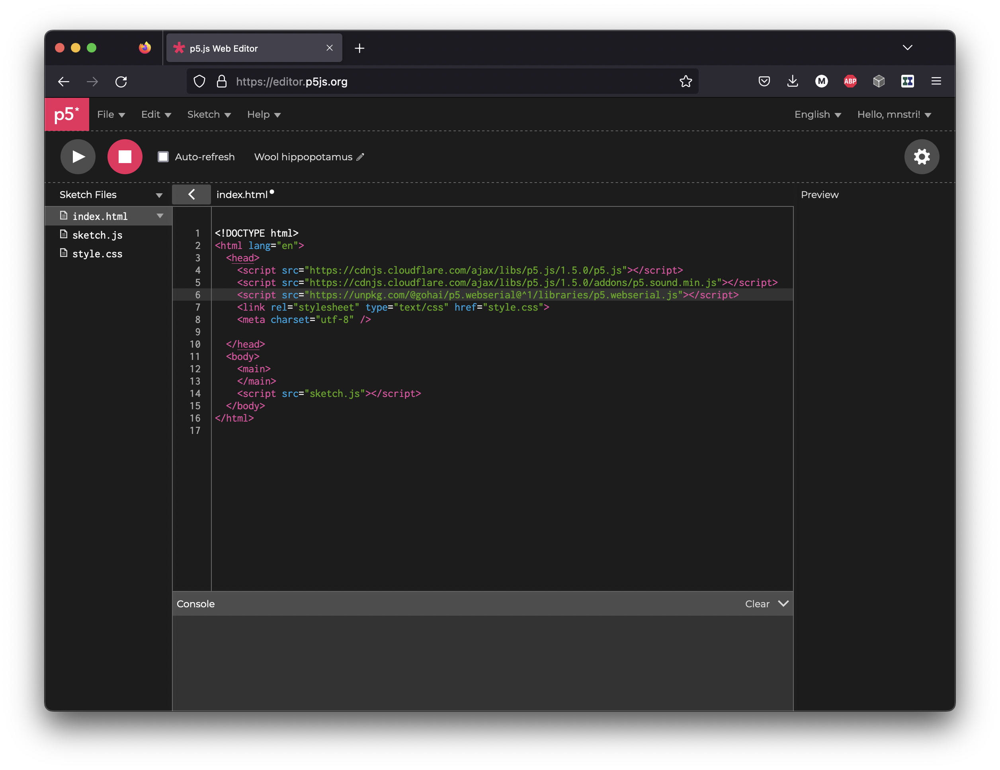
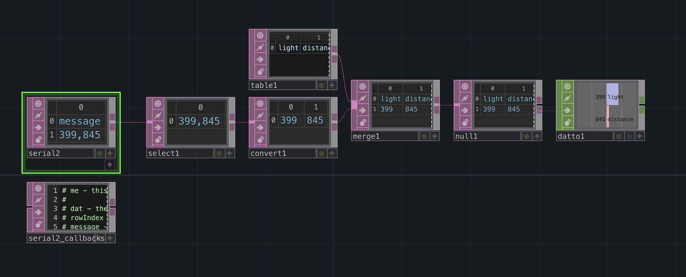

## Serial

Arduino has two built-in tools for receiving and/or sending serial data.

- Serial Monitor
- Serial Plotter

We have already used them both, mainly for seeing data printed from the sensors we use.

You can also use serial communication with other software on your computer.


### Circuit

- Light sensor connected to pin A0
- The VL53L1X distance sensor connected to the I2C bus using the Qwiic connector


We have this done with our robot we built last week so just keep that connected.


### Arduino Code

Upload the following code to your board. It reads the two sensor data and prints out the data on one line with the values separated by a comma.

```c
// add all necessary libraries
#include <Wire.h>
#include <Adafruit_MSA301.h>
#include <Adafruit_Sensor.h>

// Comment/Uncomment as needed for specific MSA being used:
Adafruit_MSA311 msa;
//Adafruit_MSA301 msa;

float x,y,z;

void setup() {
  // put your setup code here, to run once:
  Serial.begin(115200);
  if (! msa.begin()) {
        Serial.println("Failed to find MSA301/311 chip");
        while (1) { delay(10); }
    }
  Serial.println("MSA301/311 Found!");
}

void loop() {
  // put your main code here, to run repeatedly:
    // get X Y and Z data at once
    msa.read(); 
    
    x = msa.x;
    y = msa.y;
    z = msa.z;

    // print the values
    Serial.print(x);
    Serial.print(",");
    Serial.print(y);
    Serial.print(",");
    Serial.println(z);
    delay(50);
}
```


Make sure you close all Serial Monitors from the Arduino IDE before testing in other software.


### Option #1: p5.js code

We can use the p5.webserial library to communicate with the Arduino board directly from the browser. [See the documentation](https://github.com/gohai/p5.webserial/) of the library.

You can create a p5.js sketch to read the data from the serial port. This works with [the online editor](https://editor.p5js.org/) as well.


Note that you have to use a browser that supports the Web Serial API, such as Chrome, for this to work.


First, open the `index.html` file and add the following inside the `head` tags to include the library:

```html
<script src="https://unpkg.com/@gohai/p5.webserial@^1/libraries/p5.webserial.js"></script>
```

[](./img/p5js-editor-serial.png)

Then use the code below. If everything went as expected, you should be able to connect to your Arduino and see the data coming in.

[Open the example in the p5.js editor.](https://editor.p5js.org/mnstri/sketches/EJv7jPl3K)

```js
let port;
let x,y,z;
let c;
let s=10;
let circleX=0;
let circleY=0;

function setup() {
  createCanvas(400, 400);
  port = createSerial();
  c = color(255);
}

function draw() {
  background(130,70,90);
  
  if(port.available()>0){
    let str = port.readUntil("\n");
    if(str != null){
      //console.log(str);
      let splitData = split(str, ',');
      x = splitData[0];
      y = splitData[1];
      z = splitData[2];
      port.clear();
      circleX = map(x,-2000,2000,0,width);
      circleY = map(y,-2000,2000,0,height);
    }
  }
  
  fill(255);
  text("x: " + x,20,20);
  text("y: " + y,20,40);
  text("z: " + z,20,60);
  //fill(c);
  circle(circleX, circleY, 100);
}

function mousePressed(){
  if (!port.opened()) {
    port.open(115200);
  }
}
```

#### Another p5.js example

Some other p5.js examples **(open in Chrome)**

- [Eye Plops](https://editor.p5js.org/mnstri/sketches/hEWJR0Ons) (this one uses the same Arduino code as above)

### Option #2: Processing code

You can also do the same thing using Processing. The Serial library comes built-in with Processing so you don't need to install anything extra. Just include the library in your code.

```java
import processing.serial.*;

Serial myPort;  // Create object from Serial class
String str;      // Data received from the serial port
float x,y,z;
float circleX;
float circleY;
float s=100;

void setup(){
  size(500, 500);
  // Open whatever port is the one you're using.
  // Change the 0 in  Serial.list()[0] to the correct device
  printArray(Serial.list());
  String portName = Serial.list()[5];
  myPort = new Serial(this, portName, 115200);
}

void draw(){
  if ( myPort.available() > 0) {  // If data is available,
    str = myPort.readStringUntil('\n');         // read it and store it in str
    if(str != null){
      String[] splitData = split(str, ",");
      x = float(splitData[0]);
      y = float(splitData[1]);
      z = float(splitData[2]);
      circleX = map(x,-2000,2000,0,width);
      circleY = map(y,-2000,2000,0,height);
    }
  }
  background(130,70,90);   
  fill(255);
  text("x: " + x,20,20);
  text("y: " + y,20,40);
  text("z: " + y,20,60);
  circle(circleX, circleY, s);
}
```

### Option #3: TouchDesigner Example

[](./img/td-serial-dat.jpg)

There are two ways to use serial communication in TouchDesigner:

1. Using the Serial CHOP | This is useful when you are only receiving one value
2. Usingt the Serial DAT | Use this for more complex cases or when you need to receive multiple values

[Download a TouchDesigner example of reading the values from the Serial Port.](./files/ArduinoToTDSerial.toe)